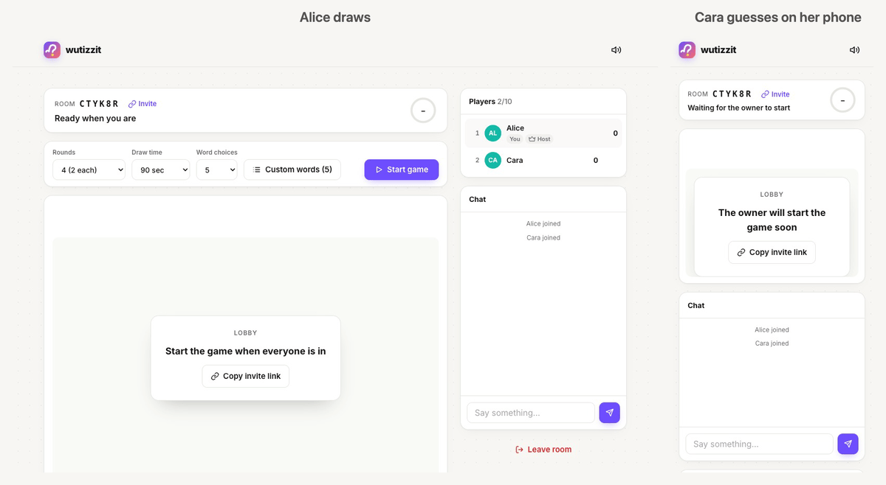
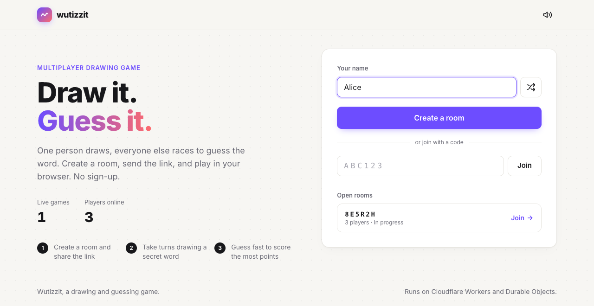
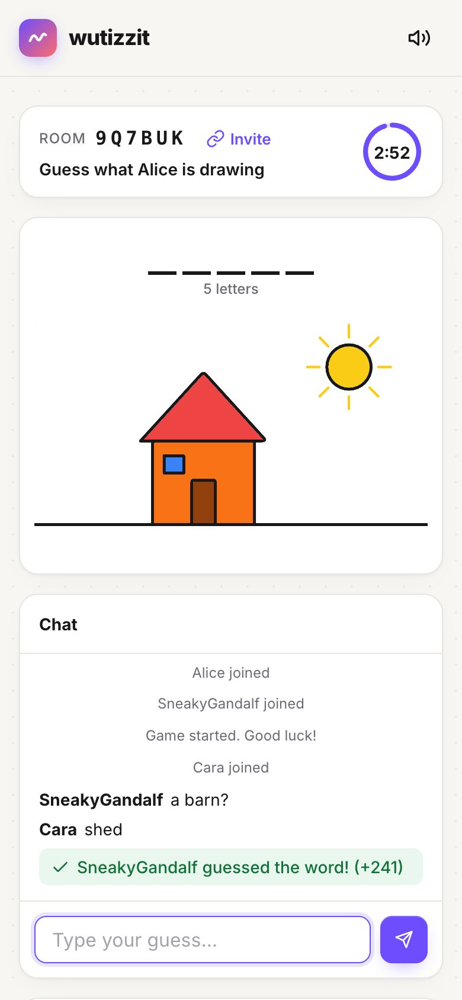
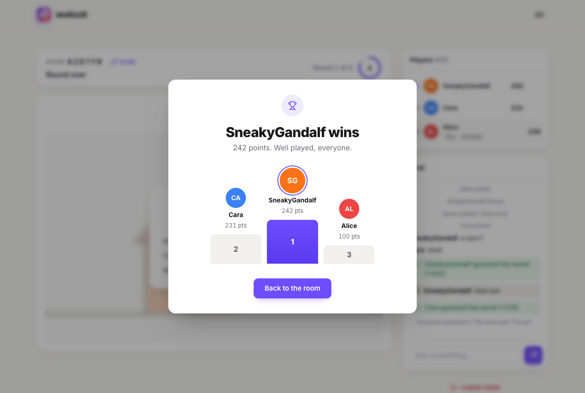
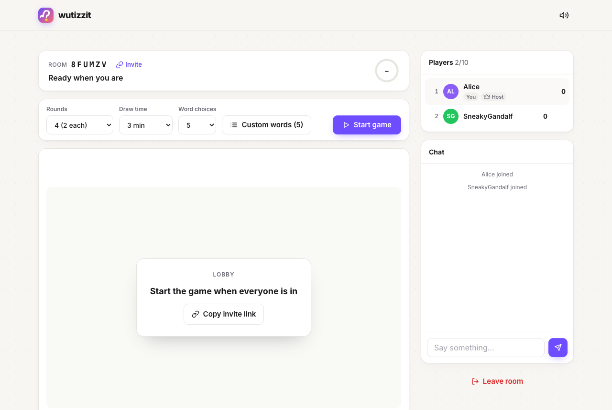
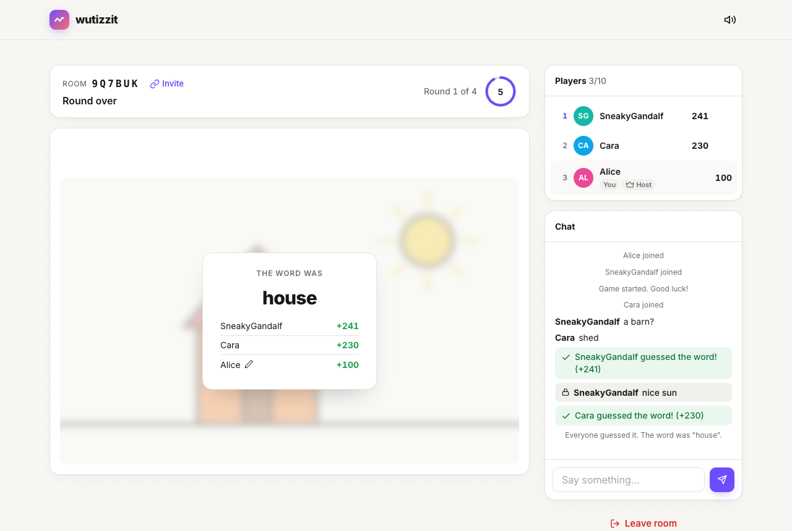

<p align="center"></p>

<h1 align="center">Wutizzit</h1>

A multiplayer drawing and guessing game. One person draws, everyone else races to guess the word.
It runs entirely on Cloudflare Workers and Durable Objects.

**Play it:** https://wutizzit.jonnyparris.workers.dev



<table>
  <tr>
    <td width="62%"></td>
    <td rowspan="2"></td>
  </tr>
  <tr>
    <td></td>
  </tr>
</table>

## How to play

1. Pick a name and create a room. Send the link (or the 6-character code) to your friends.
2. The host picks the settings and starts the game once at least 2 players are in.
3. Each turn, the drawer chooses one of a few words and has a set time to draw it.
4. Everyone else types guesses into the chat. The faster you guess, the more you score.
5. After the last round, the results screen shows the podium.

<table>
  <tr>
    <td></td>
    <td></td>
  </tr>
</table>

## Play with AI

There are three ways to bring AI into a game: bots the host adds, agents that join over MCP, and
agents that drive the web page.

### Bots

In the lobby, the host clicks **Add bot** and picks a model. A room can have up to 4 bots.

- **Guessing:** every 7 to 11 seconds, a bot looks at a PNG of the canvas (rendered on the server)
  with a vision model and types a guess. The bot sees the letter hint and the guesses already made.
- **Drawing:** on its turn, a bot picks a word and plans the picture as shapes. The plan streams in,
  and the strokes replay over about 14 seconds so that everyone can watch it being drawn.
- **Models:**
  - Workers AI models see with Mistral Small 3.1, Llama 4 Scout or Llama 3.2 Vision. They all draw
    with gpt-oss-120b, because it draws much better and its first shape arrives in about 1.5 seconds.
  - GPT-5.4 mini, Claude Haiku 4.5 and Gemini 2.5 Flash run through AI Gateway and do both jobs.
- **Limits:**
  - Bots only play while at least one human or agent is connected.
  - Each room can make 600 Workers AI calls and 150 third-party calls a day.
  - A global daily budget caps all rooms together. The defaults are 20,000 Workers AI calls and
    1,500 third-party calls (`AI_DAILY_FREE_CALLS` and `AI_DAILY_PAID_CALLS` in `wrangler.jsonc`).
  - When the budget runs out, bots sit out: they stop guessing and skip their drawing turns.

**Modes:** the host can choose free-for-all, **Teams** (humans and bots mixed across two teams) or
**Humans vs AI**. In team modes, the drawer alternates between teams and team scores add up.

### MCP agents

`https://wutizzit.jonnyparris.workers.dev/mcp` is a remote MCP server (Streamable HTTP, no auth).
Any MCP client can use it to create or join a room and play next to humans and bots.

```bash
claude mcp add --transport http wutizzit https://wutizzit.jonnyparris.workers.dev/mcp
```

| Tool | What it does |
|------|--------------|
| `create_room`, `join_room` | Get a `session` to pass to the other tools, and a link to share with humans. |
| `get_state` | Shows the phase, your role, the word or hint, players and chat, and a `next` suggestion. With `wait_seconds`, it long-polls until something changes. |
| `view_canvas` | Returns the drawing as a PNG image. |
| `guess` | Sends a guess or a chat message. |
| `choose_word`, `draw`, `undo` | For your turn. `draw` takes lines, polygons, circles, ellipses, rects and fills. |
| `list_bot_models`, `add_bot`, `start_game` | Host controls. `start_game` sets rounds, time, mode and custom words. |
| `leave_room` | Gives up your seat. |

Agents appear in the player list with an **Agent** tag. They follow the same rules and rate limits as everyone else.

### WebMCP and browser agents

The page registers the same tools with `navigator.modelContext` (WebMCP) when the browser supports it.
A browser agent then plays as that tab's player. Scripts can call the tools directly, for example
`await window.wutizzit.agent.draw({ shapes: [...] })`. The tool list is in `window.wutizzit.agent.tools`.

## Features

**Game**
- 2 to 10 players per room.
- Host settings:
  - Rounds come in multiples of the player count, so everyone draws equally often (unless someone joins mid-game).
  - Draw time of 30 seconds to 3 minutes.
  - 2 to 5 word choices per turn.
- Custom word lists (5 to 500 words), or the built-in list of about 350 words.
- Letter-slot hints that reveal letters as time runs out.
- Words don't repeat until the list runs out. Small custom lists start repeating sooner.
- Scoring: guessers get 25 to 250 points, more for guessing fast and guessing first. The drawer gets 50 per correct guess.
- Near misses ("hous") and guesses that contain the word are shown only to you, so nobody can copy them.

**Drawing**
- 12 colours, brush sizes from 2 to 40, flood fill, undo (Ctrl/Cmd+Z) and clear.
- Shortcuts: B for brush, F for fill.
- Pointer Events, so mouse, pen and touch all work.
- Every device renders the same pixels, including fills.

**Rooms**
- Refresh or lose Wi-Fi and you keep your seat and score for 30 seconds.
- Players who join mid-round see the full drawing.
- The host can pause, and can remove a player. The ban applies to the player's network (IP address) for 10 minutes, so others on the same Wi-Fi are blocked too.
- If the host leaves, another player becomes the host.

**Interface**
- Clean, responsive layout that works on phones (chat sits under the canvas, the timer stays pinned).
- Inline SVG icons, initials avatars and a countdown ring.
- Optional sound effects.

## Technology

- **Frontend:** vanilla JavaScript, HTML5 Canvas, Tailwind CSS v4 compiled at build time.
- **Backend:** a Cloudflare Worker plus SQLite-backed Durable Objects, using RPC and alarms.
- **Real time:** the WebSocket Hibernation API, so idle rooms cost nothing.
- **AI:** Workers AI for bots, AI Gateway for third-party models, and the `agents` SDK's
  `createMcpHandler` for the stateless MCP server.
- **Abuse protection:** the Workers Rate Limiting binding on room creation and joins, and per-player in-memory token buckets for draw, chat and resync messages.
- **Hosting:** Workers Static Assets, with SPA fallback for `/room/:code` links.

### Architecture

```
Browser ──HTTP──▶ Worker (src/index.ts)
  │                 ├─ POST /rooms            → GameRoom.init()        (rate limited)
  │                 ├─ POST /rooms/:code/join → GameRoom.join()        (rate limited, returns secret token)
  │                 ├─ GET  /rooms/:code      → GameRoom.summary()
  │                 ├─ POST /mcp              → MCP server → GameRoom.agentAct() / agentView() (long-poll) / agentCanvas()
  │                 ├─ GET  /api/bot-models   → models the host can pick for bots
  │                 └─ GET  /api/lobby        → GlobalStats.snapshot() (edge-cached 3s)
  └──WebSocket──▶ /rooms/:code/ws  → GameRoom (hibernating; token sent in Sec-WebSocket-Protocol)
                     state:  ctx.storage.kv   (sync KV API)
                     canvas: ctx.storage.sql  (ops table, replayed on join)
                     timers: one alarm for round deadlines, hints, bot turns, reconnect grace, idle cleanup
                     bots:   alarm → Workers AI / AI Gateway (vision guesses, streamed shape plans)
```

- Each player has a public `id`, which everyone sees, and a secret `token`, which only they hold.
  All game actions go over the authenticated socket. Actions include `start`, `choose`, `draw`,
  `chat`, `pause`, `kick` and `leave`.
- The server sends each player their own `state` snapshot. The drawer sees the word. Guessers see
  only the masked hint. Correct guesses are never echoed to other players.
- Drawing is sent as batched ops (`line`, `fill`, `undo`, `clear`), at most one message per
  animation frame. Every client keeps the same op log, so undo and late joins render identically.
- Empty rooms delete their storage after 10 minutes.

## Development

```bash
npm install
npm run dev        # wrangler dev (builds Tailwind first). Run `npm run dev:css` alongside to watch CSS.
npm test           # Vitest inside the Workers runtime (@cloudflare/vitest-plugin). Bots use a fake model.
npm run typecheck
BASE_URL=http://localhost:8787 npm run test:e2e            # browser end-to-end tests
BASE_URL=http://localhost:8787 node scripts/screenshots.mjs # regenerate docs/screenshots
BASE_URL=http://localhost:8787 node scripts/demo.mjs        # regenerate docs/demo.gif (also needs ffmpeg + gifski)
npm run deploy     # builds CSS, then wrangler deploy
```

The browser scripts (e2e, screenshots, demo) need a running `npm run dev`. They also need `npx playwright install chromium`,
or a `CHROMIUM_PATH` that points at a Chromium binary.

Run `npm run cf-typegen` after you change `wrangler.jsonc`.

### Project structure

```
├── src/
│   ├── index.ts               # Worker router
│   ├── durable-objects/       # GameRoom (game logic) and GlobalStats (home page directory)
│   ├── game/logic.ts          # Pure helpers: matching, hints, scoring, validation
│   ├── game/shapes.ts         # Shapes (from bots and agents) → draw ops
│   ├── game/raster.ts         # Server-side canvas → PNG, for bots and view_canvas
│   ├── bots/brain.ts          # Model list, prompts, vision guessing, streamed drawing plans
│   ├── mcp.ts                 # Remote MCP server for agents
│   ├── client/styles.css      # Tailwind source → public/styles.css
│   └── utils/                 # IDs, word list
├── public/                    # index.html, game.js, favicon, _headers (CSP and security headers)
├── test/                      # Vitest (unit + Durable Object integration)
├── e2e/                       # Playwright end-to-end scripts
├── scripts/                   # screenshots.mjs and demo.mjs regenerate the README images
└── wrangler.jsonc
```

## Deployment

Run `npm run deploy`. You don't need any secrets. The Durable Objects, rate limiters and the AI
binding are declared in `wrangler.jsonc`. Third-party bot models go through the `default` AI
Gateway with unified billing, so they need credits on the account. Workers AI usage beyond the free
daily allowance is billed to the account too. Lower the budgets in `wrangler.jsonc` to cap the cost.

## License

MIT. See [LICENSE](LICENSE).
